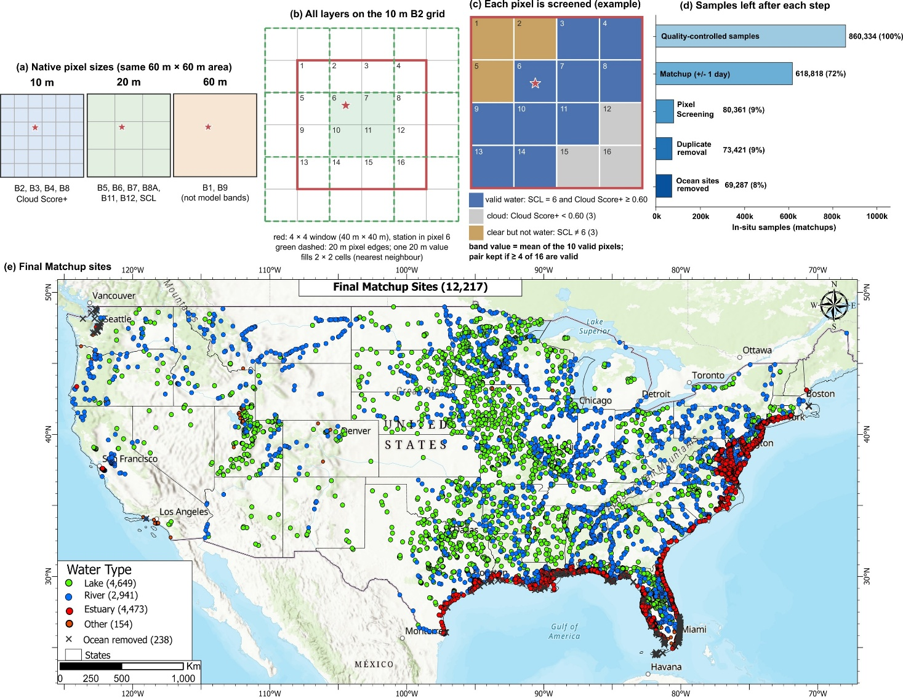
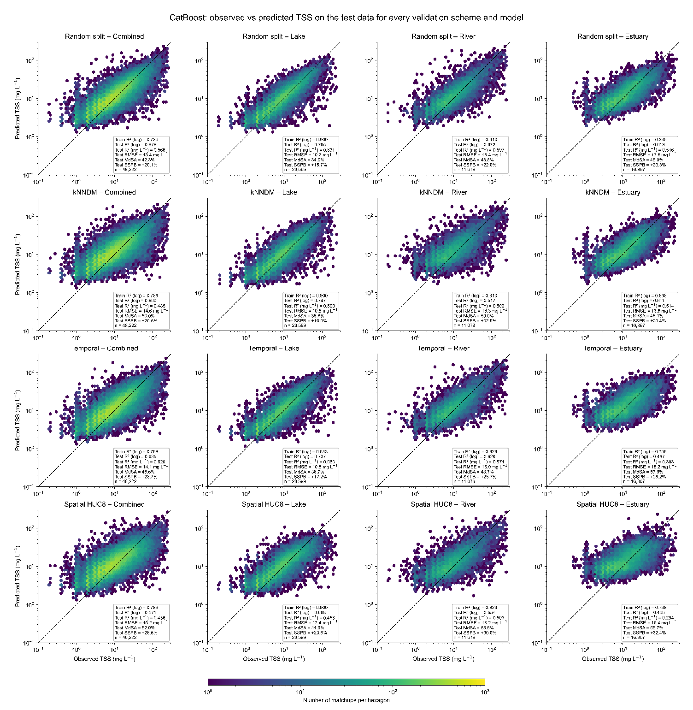
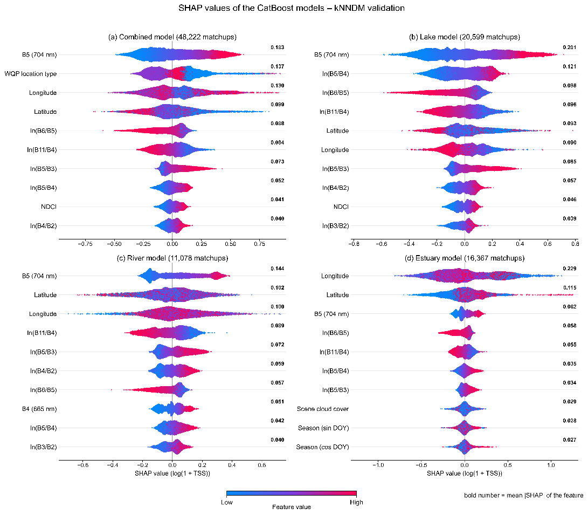
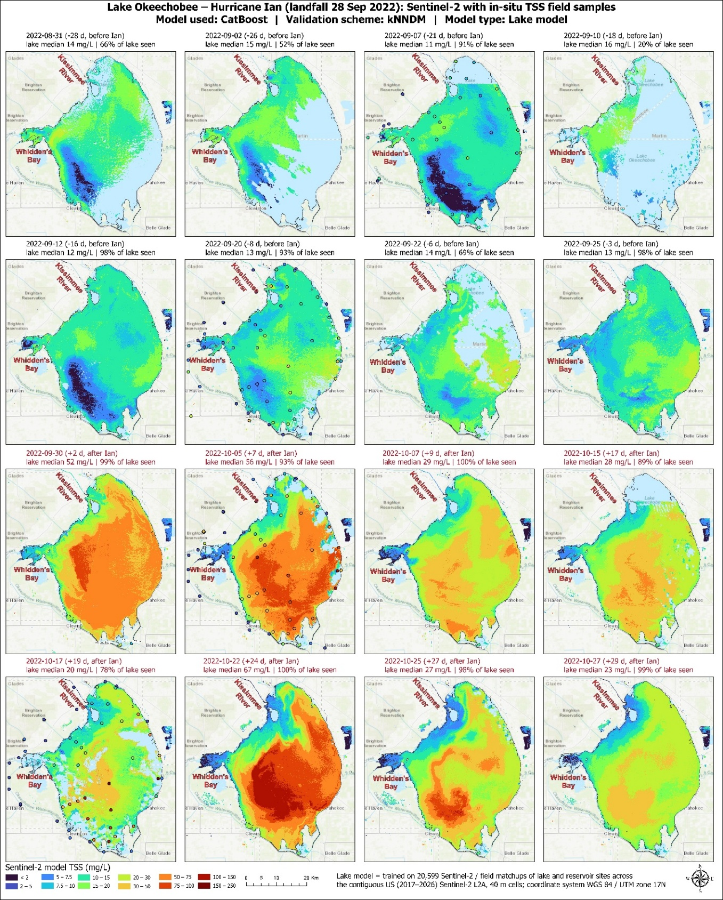
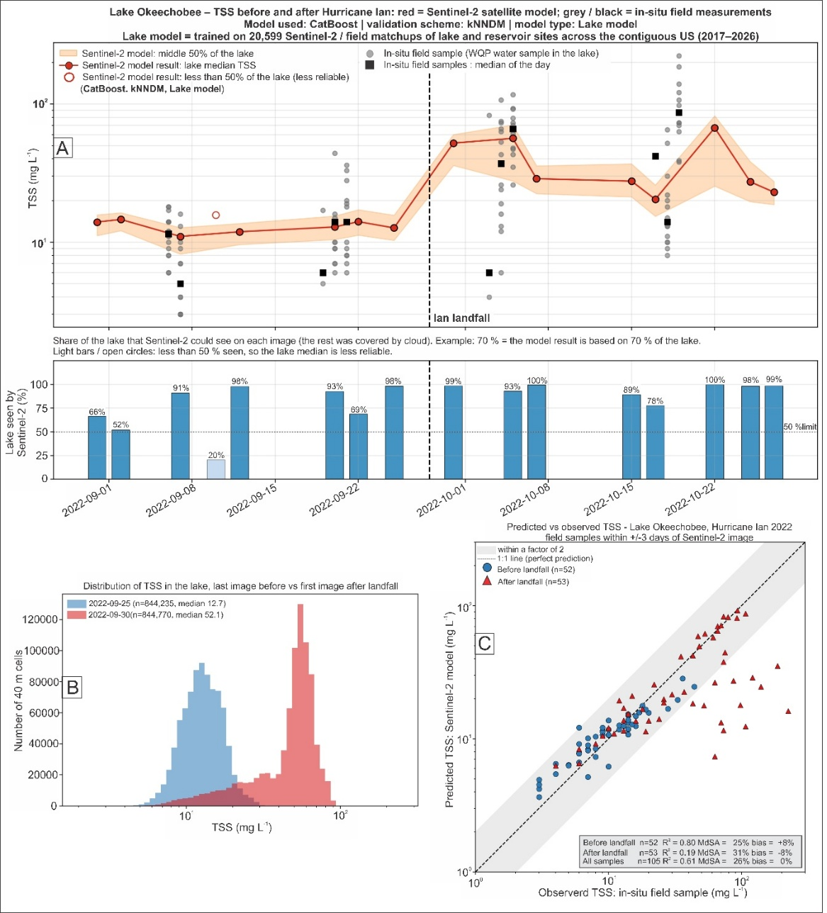

# TSS-Sentinel-2-ML

Code and data for the paper

**Machine Learning and Spatial Validation for Sentinel-2 Total Suspended Solids Retrieval across the United States**
Onur Karaca, Shuhab Khan, Gultekin Erten (University of Houston)

Field TSS from the Water Quality Portal (WQP) is matched with Sentinel-2 L2A images taken within one day
of sampling. Five machine-learning algorithms and three standard TSS algorithms are tested with four
validation schemes (random split, kNNDM, temporal, basin-based HUC-8), and the models are applied to
Lake Okeechobee (Hurricane Ian, 2022) and the Houston Ship Channel (Tropical Storm Imelda, 2019).

## Contents

```
data/final_TSS.parquet          final matchup dataset: 69,287 matchups at 12,217 sites (one row per matchup)
models/CatBoost_kNNDM_*.pkl     final CatBoost models (Combined, Lake, River, Estuary), kNNDM scheme
figures/                        Figures 3 and 5-8 of the paper (shown below)
code/
  step1_clean_wqp.py            WQP records -> 860,334 quality-controlled TSS records
  step2_matchup_gee.py          Sentinel-2 images of every record (Google Earth Engine, +-1 day, 4 x 4 pixels)
  step3_screen_pixels.py        water/cloud pixel screening, duplicate removal, ocean sites -> final_TSS.parquet
  step4_train_models.py         5 algorithms x 4 validation schemes x 4 models
  step5_standard_algorithms.py  log-linear red/NIR, Nechad et al. (2010), Dogliotti et al. (2015)
  step6_shap.py                 SHAP values of the final models
  step7_storm_maps.py           TSS maps before and after the two storms
  step8_field_comparison.py     storm maps compared with field TSS
  tss_model.py                  apply a model file to Sentinel-2 data
```

## Set-up

Python 3.13

```
pip install -r requirements.txt
```

Steps 2 and 7 need a Google Earth Engine account (`earthengine authenticate`); write your Earth Engine
project in `EE_PROJECT` at the top of `step2_matchup_gee.py` and `step7_storm_maps.py`.
Step 7 downloads Sentinel-2 L2A data from the Microsoft Planetary Computer (no account needed) with `curl`.

## Run

All scripts are run from the `code` folder. Outputs go to `data/` and `results/`.

```
python step1_clean_wqp.py
python step2_matchup_gee.py
python step3_screen_pixels.py
python step4_train_models.py
python step5_standard_algorithms.py
python step6_shap.py
python step7_storm_maps.py okeechobee
python step7_storm_maps.py houston
python step8_field_comparison.py okeechobee
python step8_field_comparison.py houston
```

`data/final_TSS.parquet` is included, so steps 1-3 can be skipped: the models can be trained directly
with step 4. One combination takes up to about an hour on a desktop PC (CatBoost, kNNDM, River model:
41 minutes), so all 80 take days. One combination at a time:

```
python step4_train_models.py --algorithm CatBoost --scheme knndm --model Lake
```

Steps 1 and 2 need the WQP download used in the paper, `WQP_TSS_records.parquet` (1,780,020 TSS and SSC
records, 127 MB). It is attached to the release
[v1.0](https://github.com/onurkaraca87/TSS-Sentinel-2-ML/releases/tag/v1.0); put it in `data/raw/`.
The kNNDM folds (step 4) also need the output of step 1.

## Using a model

```python
import tss_model
bundle = tss_model.load("../models/CatBoost_kNNDM_Lake.pkl")
cells = tss_model.cells_from_image(bands, scl, cloud_score, lon, lat, date="2022-09-30",
                                   location_type="Lake, Reservoir, Impoundment", scene_cloud_pct=0.0)
tss = tss_model.predict_tss(bundle, cells)      # mg/L per 40 m cell, NaN outside the training limits
```

`bands` are the ten L2A bands (B2-B8A, B11, B12) as reflectance (0-1) on the 10 m grid, `scl` the Sen2Cor
scene classification and `cloud_score` the Cloud Score+ `cs_cdf` band on the same grid. See
`step7_storm_maps.py` for a full example.

## Figures

Figures 3 and 5-8 of the paper.

**Figure 3.** Sentinel-2 matchup: band resolution, 4 x 4 pixel window, pixel screening, records left after
each step and the 12,217 sites of the final dataset.



**Figure 5.** Observed versus predicted TSS of CatBoost on the test data for the four validation schemes
(rows) and the Combined, Lake, River and Estuary models (columns).



**Figure 6.** SHAP values of the ten most important features of the CatBoost models (kNNDM scheme).



**Figure 7.** Sentinel-2 TSS maps of Lake Okeechobee for the 16 images between 31 August and 27 October 2022
(Hurricane Ian landfall: 28 September 2022; CatBoost, kNNDM, Lake model; 40 m cells).



**Figure 8.** Lake Okeechobee before and after Hurricane Ian: lake-wide median TSS with field samples (A),
TSS distribution before and after landfall (B) and maps compared with field samples (C).



## License

MIT (see `LICENSE`). The WQP and Sentinel-2 data keep the terms of their providers.

## Data sources

- Water Quality Portal: https://www.waterqualitydata.us
- Sentinel-2 L2A: Google Earth Engine `COPERNICUS/S2_SR_HARMONIZED`; Microsoft Planetary Computer `sentinel-2-l2a`
- Cloud Score+: Google Earth Engine `GOOGLE/CLOUD_SCORE_PLUS/V1/S2_HARMONIZED`
